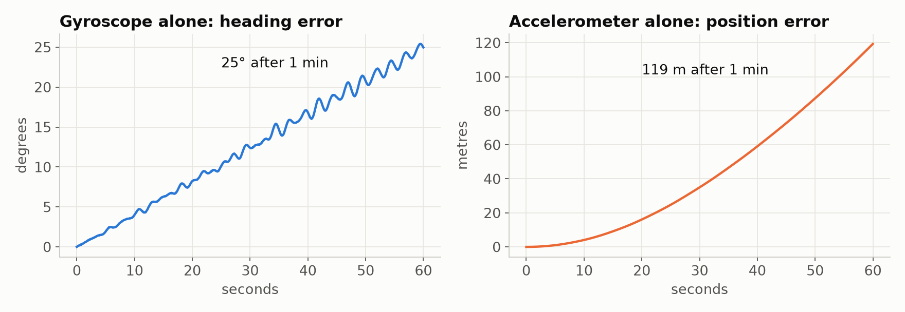
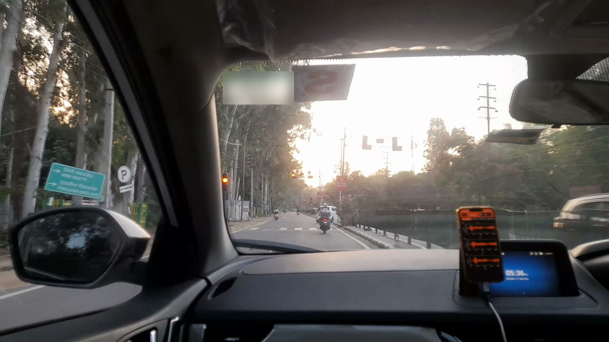
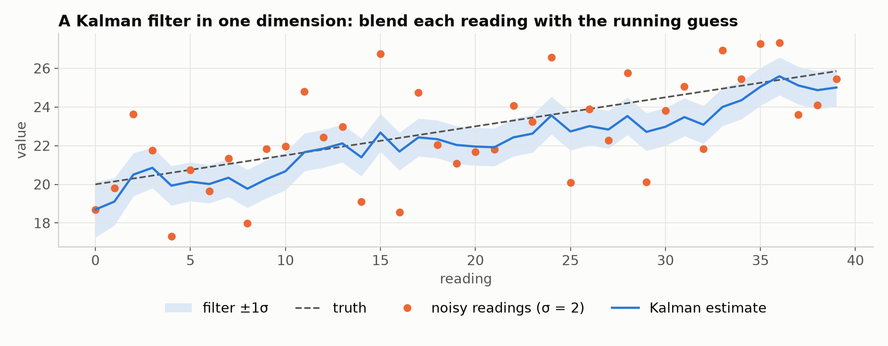
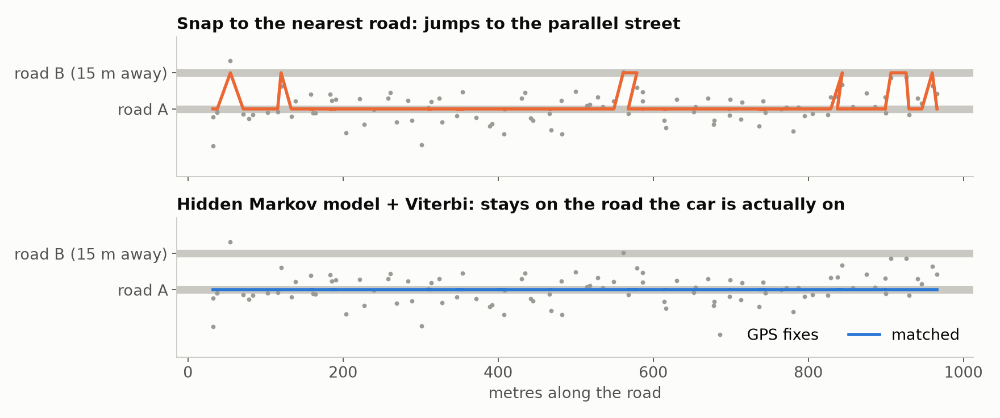
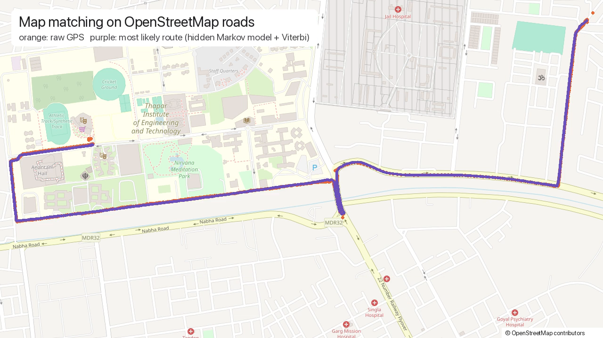
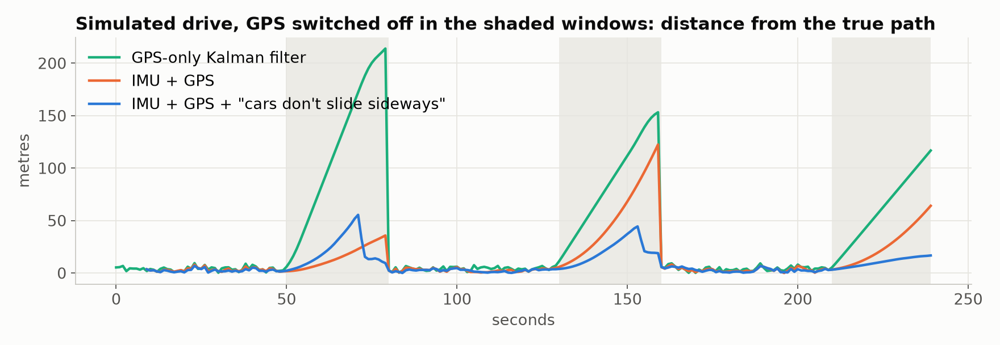

Before a map app can route you anywhere, it has to answer a simpler question: **where am I, right now?**

It sounds solved. Your phone has GPS. But stand under a flyover, drive between tall buildings, or watch the blue dot jump across the road at a junction, and you see that it isn't. What your phone shows you is a *guess*, stitched together from several sensors that each lie in their own way.

I wanted to know how that guess is made. I didn't know any sensor fusion when I started. So I learned it from zero, wrote every piece myself, and tested it on a real drive. The result is **[micronav](https://github.com/DaanishSharma/micronav)**, an open-source positioning engine in plain numpy.

👉 **[Open the live demo](https://daanishsharma.github.io/micronav/)**: the real drive on a map, with every layer you can toggle.

---

## 1. Every sensor lies

Your phone has three sensors that know something about where it is:

- **GPS** gives your position once a second, but it jumps around by several metres and drops out completely under bridges and between buildings.
- **The gyroscope** measures how fast you're turning, 100 times a second. Add those turns up and you know which way you're facing. But a bias of a fraction of a degree per second never cancels out.
- **The accelerometer** measures acceleration. Integrate it once and you get speed, twice and you get position. But every small error gets integrated twice too.

Here's what happens in a one-minute simulation where I know the true path exactly:



The gyro's error grows in a straight line: **25° off after a minute**. The accelerometer's error grows with *time squared*: **119 m off after a minute**. A tilt error of just 1° leaks 0.17 m/s² of gravity sideways, and that alone is about 300 m after a minute.

No sensor is good enough on its own. But they fail in *different* ways. GPS is noisy but doesn't drift. The motion sensors are smooth but drift. **Sensor fusion** is the art of combining them so that each one covers for the others' mistakes.

## 2. The experiment

To test any of this, I needed real data. I put an iPhone 13 on the dashboard and recorded an 11-minute, 4.3 km drive around Patiala with [phyphox](https://phyphox.org), a free, open-source app that logs every sensor in the phone.



| What I got | |
|---|---|
| Accelerometer, gyroscope, magnetometer | ~70,000 samples each, 100 per second |
| GPS | 698 fixes, one per second, median reported accuracy 4 m |
| Dashcam video | the same 11 minutes, from a second phone |

One catch: **a real drive has no ground truth.** I don't know where the car *really* was, only where GPS *said* it was. That's why every filter in micronav is first tested on a simulation with a known answer, then on the real drive.

## 3. Idea one: blend, don't choose

The core tool is the **Kalman filter**. In one dimension it fits in a few lines. You keep a **guess** and a number for **how unsure you are** about it. Every time a reading arrives, you blend it into the guess:

```python
K = P / (P + r)        # how much to trust the new reading: 0 = ignore it, 1 = take it as is
x = x + K * (z - x)    # move the guess towards the reading
P = (1 - K) * P        # we are now a little more sure
```

If you're very unsure (big `P`), you trust the reading. If the reading is noisy (big `r`), you trust your guess. Between readings, time passes and you grow less sure. That's the whole idea:



The orange readings jump by ±2. The blue estimate follows the truth far more closely, and the shaded band is the filter's own honest estimate of how wrong it might be. Everything else in micronav is this same idea, with the guess becoming a vector and the uncertainty a matrix.

## 4. Idea two: track the error, not the thing

Orientation is awkward, because rotations don't add like ordinary numbers. The trick that drones and phones use is the **error-state Kalman filter**. You keep a best guess of the orientation, and the filter tracks only the *small error* in that guess. Small errors do add like numbers. After each correction, you fold the error back into the guess and start again at zero.

With it:
- **Gravity** fixes tilt. When the phone isn't accelerating hard, the accelerometer points straight up.
- **The compass** fixes heading. It's bent by steel, though, so micronav uses a statistical gate (the *NIS*, "how surprising is this reading?") to throw away readings that don't fit. In the simulation, walking past a steel structure pulls a naive compass filter more than 15° off. The gated one stays within 5°.
- **The filter learns the gyro's bias as it goes**, to within 0.1°/s.

## 5. Idea three: let the future fix the past

A filter only knows the past. That's all you have while driving. But once the drive is over, you can run back through it and let *later* GPS fixes correct *earlier* estimates. That's the **Rauch–Tung–Striebel smoother**, and it reliably beats the filter.

It also gave me my favourite surprise. A Kalman filter can check whether its own assumptions are right: if the phone's reported GPS accuracy were honest, a statistic called NIS would average around **1.39**. On my drive it was **0.016**. The phone's fixes agree with each other far better than the phone claims. They're already smoothed inside the phone, so their errors are correlated. **Lesson: check a filter's assumptions before you trust its uncertainty.**

## 6. Idea four: cars live on roads

Snapping each GPS fix to the nearest road sounds sensible, until two roads run side by side:



micronav uses a **hidden Markov model** instead (Newson & Krumm, 2009). Each fix has several candidate positions on nearby roads. Moving between candidates costs more the more the road distance disagrees with the straight-line distance: driving straight along one road is cheap, while hopping to a parallel street needs a long detour, so it's expensive. The **Viterbi algorithm** finds the cheapest sequence over the whole trip. On the real drive, using OpenStreetMap roads:



## 7. Putting it together: one filter, fifteen numbers

The final filter tracks fifteen numbers at once: position (3), velocity (3), orientation (3), and the biases of the accelerometer (3) and gyroscope (3). **A hundred times a second, the motion sensors predict where the car went. Once a second, GPS corrects that prediction.** The filter learns both sensors' biases as it goes.


Two more ideas make it work in a car:

- **How is the phone mounted?** Nobody mounts a phone straight. micronav works it out from the drive itself. When the car brakes, the phone feels a push along the car's forward axis. When it turns, it feels a push sideways that equals speed × turn rate. GPS gives the speed and the gyro gives the turn rate, so the mount angle has a closed-form answer. On my drive it found the phone upright, with its camera facing the road, which matches the photo above.
- **Cars don't slide sideways, or take off.** Telling the filter that the car's sideways and vertical speeds are about zero turns out to be one of the most powerful pieces of information it has.

## 8. The test: pull the plug on GPS

Here's the real question: **what happens when GPS disappears?** I hid GPS for 30 seconds out of every 90 and asked each filter to guess where the car was. Then I compared those guesses with the GPS fixes they never saw.


| On the real drive | GPS hidden 30 s of every 90 s | GPS hidden 60 s of every 120 s |
|---|---|---|
| Kalman filter on GPS alone | 29 m off (median) | 55 m off |
| **micronav, 15-state filter** | **9 m off** | **28 m off** |

A GPS-only filter can only assume the car keeps going straight. micronav knows how the car turned, sped up and slowed down, and that it can't slide sideways. In the simulation, where the true path is known, you can see each piece earn its place:



The motion sensors on their own cut the drift a lot. Adding the "cars don't slide sideways" rule usually cuts it further. All of this with no extra hardware: just the sensors already in your phone.

## 9. Try it yourself

```bash
pip install git+https://github.com/DaanishSharma/micronav
micronav run "your-phyphox-recording.zip" --out map.html
```

Record a drive with phyphox (export it as CSV), run that one command, and you get an interactive map like [the demo](https://daanishsharma.github.io/micronav/). Or play with the simulations, where you know the right answer:

```python
import micronav as mn

sim = mn.simulate_drive()      # a car drive with a known path and a crooked phone mount
R_CI, _ = mn.estimate_mount(sim.t, sim.gyro, sim.accel, sim.gps_t, sim.gps_speed)
print(mn.rotation_angle_deg(R_CI, sim.R_CI), "degrees off")   # ~0.6
```

## What I learned

- **Every sensor lies, differently.** That difference is exactly what makes fusion possible.
- **Test against a known answer first.** Every bug I found, I found in a simulation, not on the real drive.
- **Check your filter's assumptions.** My phone's GPS was far more consistent than it claimed, and NIS is how I noticed.
- **Physics is free information.** "Cars don't slide sideways" costs nothing and beats fancier tricks.
- **Recursion and batch are the same answer.** The RTS smoother and one big least-squares solve give *identical* tracks for a linear model. micronav's tests check that they agree to 1e-8, and that's what made the theory click for me.

## What's next

A native phone recorder instead of phyphox, support for **NavIC** (India's own satellite navigation), and more open map sources alongside OpenStreetMap. The goal is a positioning stack that anyone can read, run and trust.

Here's the full walkthrough, if you want all of it in under three minutes:


**[Code on GitHub](https://github.com/DaanishSharma/micronav)** (MIT) · **[Live demo](https://daanishsharma.github.io/micronav/)**

*References: T. Barfoot, State Estimation for Robotics. J. Solà et al., A micro Lie theory for state estimation in robotics. P. Newson & J. Krumm, Hidden Markov map matching through noise and sparseness (2009). Map data © OpenStreetMap contributors.*
